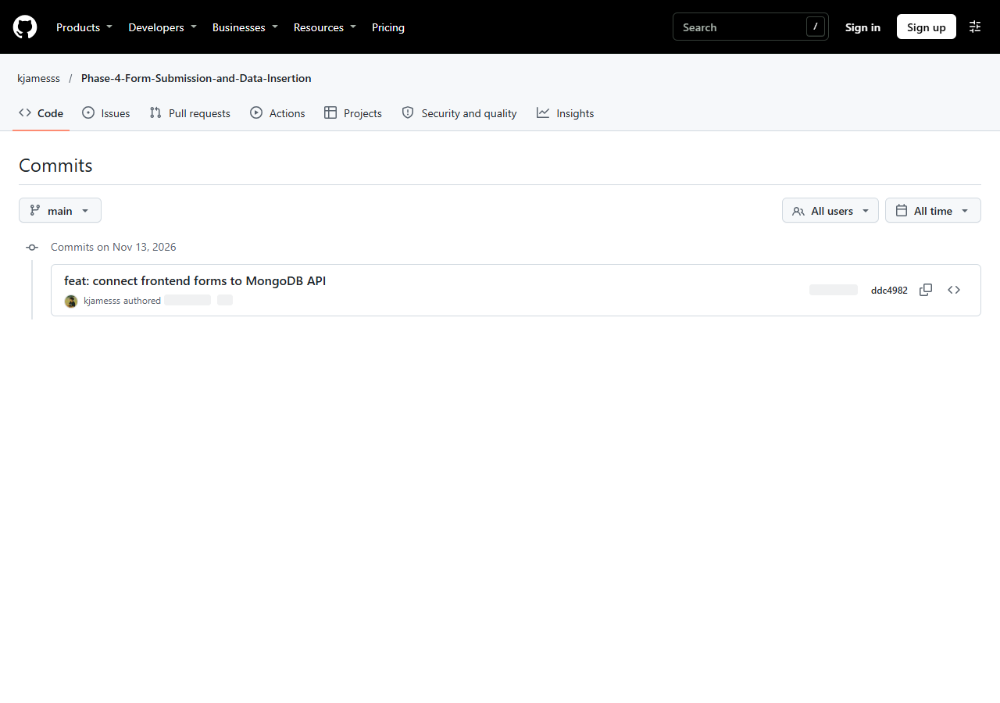
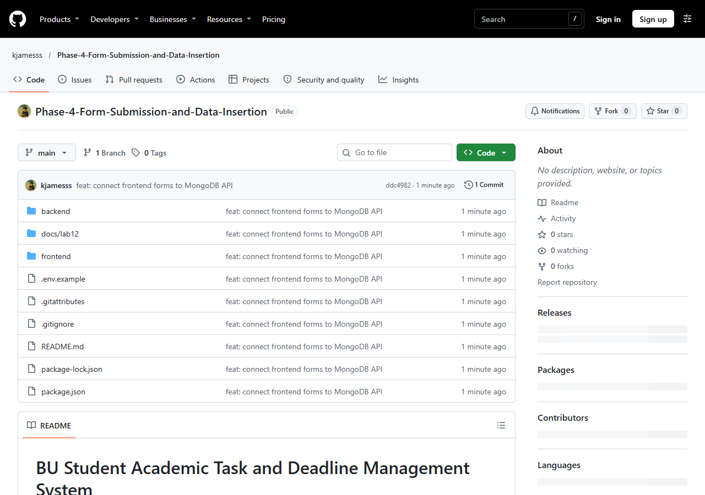

# BU Student Academic Task and Deadline Management System

IT 112 · Group 5 · BSIS-2B · Phase 4 Form Submission and Data Insertion

## Phase 4 report

[Open the Phase 4 performance report (PDF)](docs/lab12/Phase-4-Report.pdf)

The report includes the form interface, JavaScript API connection, MongoDB Atlas insertion, GitHub evidence, and individual reflections.

## GitHub commits

[View the complete commit history](https://github.com/kjamesss/Phase-4-Form-Submission-and-Data-Insertion/commits/main/)

- [Frontend and backend API integration](https://github.com/kjamesss/Phase-4-Form-Submission-and-Data-Insertion/commit/ddc4982e1d2c359be03adde428321b4b55c24652)
- [Performance report and GitHub evidence](https://github.com/kjamesss/Phase-4-Form-Submission-and-Data-Insertion/commit/aee3e0ab041ca4d4dbf539cb7b9e6ade10033b76)

## GitHub project structure

[Browse the project files](https://github.com/kjamesss/Phase-4-Form-Submission-and-Data-Insertion/tree/main)

The frontend folder contains the pink HTML pages, styles, and form handlers. The backend folder contains Express routes, Mongoose models, server startup, and integration tests. Reports and screenshots are in docs/lab12.

## Run the project

Requires Node.js 22 or later and a running MongoDB database.

1. Run npm ci in the repository root.
2. Copy .env.example to .env.
3. Set MONGODB_URI to your Atlas connection URI with database /bu_task_planner. URL-encode special characters in the database password.
4. Set JWT_SECRET to a random value of at least 32 characters. Keep .env private.
5. Allow your computer's public IP in Atlas Network Access and use a database user with read/write access to bu_task_planner.
6. Run npm start, or npm run dev for watch mode.
7. Open http://localhost:3000/register.html. Register a classroom account, follow Add an academic task, create a subject, then submit a task.

Express serves the pink frontend and API together. For the separate Live Server workflow, open frontend/register.html using http://localhost:5500 or http://127.0.0.1:5500 and keep the backend on port 3000. Use the same hostname for both servers so the session cookie is available. FRONTEND_ORIGINS controls the permitted frontend origins.

The port can be changed in .env. When using a custom port, open the frontend through Express on that port. The documentation run used port 3001 for the Atlas browser tests.

## Phase 4 implementation

| Form | Endpoint | Saved ERD fields |
| --- | --- | --- |
| Register | POST /api/users | Users.name, email, passwordHash, default role, createdAt, updatedAt |
| Add subject | POST /api/categories | Categories.name, optional color, authenticated owner, createdAt |
| Create task | POST /api/tasks | Tasks.title, description, dueDate, priority, status, optional category, authenticated owner, createdAt, updatedAt |

POST /api/login authenticates an existing user. Registration also signs the new account in. A signed, expiring HttpOnly cookie identifies the current user. Client-supplied roles and owners are ignored. The backend verifies that a selected category belongs to the current user.

GET /api/session and GET /api/categories provide the account context and subject choices needed by the insertion forms. POST /api/logout clears the session. GET /api/health reports database availability.

The Phase 3 dashboard, sample task list, profile, administrator page, and edit/delete dialogs remain interface previews for later reading and update work. The connected entry point for this lab is frontend/add-task.html. Registration, login, task creation, and subject creation send real requests.

## Validation and feedback

- Browser validation checks required names, task titles, email, deadline, and password length. Whitespace-only names and titles are rejected.
- Server validation checks types, lengths, valid calendar dates, status/priority enums, optional category ownership, and display color format.
- The unique email index handles duplicate registrations, including concurrent submissions.
- Passwords are hashed with bcrypt before insertion. Hashes and session tokens are excluded from JSON responses and evidence exports.
- Submission buttons are disabled while saving. Successful responses show the saved record ID and reset the form. Failed requests retain inputs, show an error, and restore the button.
- The API returns JSON for invalid input, duplicate emails, missing sessions, unknown API routes, oversized requests, and database errors.
- Fetch handles HTTP failures, invalid JSON, timeouts, and network failures. CORS supports the documented Live Server origins.

## Verify the API

Import docs/lab12/Phase-4.postman_collection.json into Postman and run it against the backend. It creates a unique example.test email for each run, registers the user, checks duplicate-email handling, creates a subject and task, and checks invalid task input.

The same collection can be run with the official Postman collection runner CLI.

    npx newman run docs/lab12/Phase-4.postman_collection.json

For a custom backend port, pass --env-var baseUrl=http://localhost:3001.

Run npm test for the 11 automated integration tests. These tests start a disposable real MongoDB process and use a separate test database. They cover hashing, normalized email, duplicates, invalid input, session enforcement, optional categories, owner protection, references, CORS, and JSON errors.

## Documentation and evidence

The [documentation folder](docs/lab12/) includes screenshots, the [Postman collection](docs/lab12/Phase-4.postman_collection.json), a [sanitized Postman test summary](docs/lab12/postman-results.json), and an [Atlas readback export](docs/lab12/atlas-insertion-proof.json). The database export contains only classroom sample records. The password hash is omitted.

The project follows the three Phase 1 collections, Users, Tasks, and Categories. The pink responsive interface continues the Phase 3 design. The report uses portrait pages, black text, and color screenshots.

## Group roles

| Member | Role |
| --- | --- |
| Bea Roshan O. Pabilona | Project Manager and Documentation Officer |
| Eleanor Aimee O. Reantaso | Front-End Developer / Front-End Manager |
| Christian A. Balauro | Backend Developer / Back End-Manager |
| Simranjit S. Singh | Database Manager |
| Karl James Matias | GitHub Manager |
